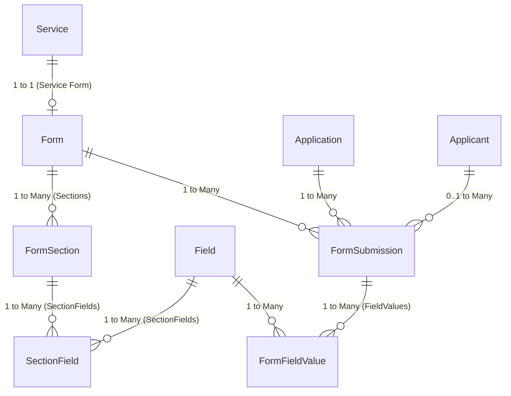

# Dynamic Form Builder Architecture & Database Schema

## Overview
The NTC-EDGE Dynamic Form Builder allows agencies to dynamically define, sequence, and validate application forms per service catalog (`Service`).

Forms are structured into ordered **Sections**, which contain ordered **Fields** with custom validation rules and conditional visibility.

---

## 1. Entity Relationship Diagram (ERD)

---

## 2. Table Schemas & Relational Mapping

### 2.1 `Forms` Table
Represents a dynamic form definition tied to a specific `Service`.

| Column | Type | Constraints | Description |
| :--- | :--- | :--- | :--- |
| `Id` | `uuid` | PK | Primary Key |
| `ServiceId` | `uuid` | FK -> `Services.Id` | Service catalog item this form belongs to |
| `Version` | `varchar` | Default `"1.0"` | Schema versioning |
| `CategorySelectionRequired` | `boolean` | Default `false` | Indicates if service variant selection is required |
| `CreatedAt` / `CreatedBy` | `timestamp`/`varchar` | Auditable | Audit metadata |
| `LastModifiedAt` / `LastModifiedBy` | `timestamp`/`varchar` | Auditable | Audit metadata |
| `IsDeleted` | `boolean` | Soft Delete | Soft delete flag |

### 2.2 `FormSections` Table
Represents a logical grouping of fields (e.g., "General Information", "Technical Specifications").

| Column | Type | Constraints | Description |
| :--- | :--- | :--- | :--- |
| `Id` | `uuid` | PK | Primary Key |
| `FormId` | `uuid` | FK -> `Forms.Id` (Cascade) | Parent Form |
| `Key` | `varchar` | Required | Unique section identifier matching contract key |
| `Title` | `varchar` | Required | Section title displayed on UI header |
| `OrderIndex` | `int` | Default `0` | Order of appearance within the form |

### 2.3 `Fields` Table
Global library of reusable form fields.

| Column | Type | Constraints | Description |
| :--- | :--- | :--- | :--- |
| `Id` | `uuid` | PK | Primary Key |
| `FieldType` | `varchar` | Enum/String | `text` \| `date` \| `dropdown` \| `checkbox` \| `signature` \| `file` |
| `Label` | `varchar` | Required | Default label text |
| `ValidationRules` | `jsonb` / `text` | Nullable JSON | Validation constraints (regex, min/max, options) |
| `IsOtherEnabled` | `boolean` | Default `false` | Enables "Other (Specify)" input for dropdowns |
| `SyncBackOnSubmit` | `boolean` | Default `false` | Syncs field back to applicant/company profile |

### 2.4 `SectionFields` Join Table
Join table mapping fields to sections with section-specific overrides and display ordering.

| Column | Type | Constraints | Description |
| :--- | :--- | :--- | :--- |
| `FormSectionId` | `uuid` | PK, FK -> `FormSections.Id` (Cascade) | Target Section |
| `FieldId` | `uuid` | PK, FK -> `Fields.Id` (Restrict) | Linked Field |
| `IsRequired` | `boolean` | Default `false` | Whether field is mandatory in this section |
| `OrderIndex` | `int` | Default `0` | Field position within the section |
| `VisibilityCondition` | `text` / `jsonb` | Nullable | Conditional visibility rule expression |

---

## 3. Submissions & User Values

When applicants submit a dynamic form, their responses are stored in `FormSubmissions` and `FormFieldValues`.

### 3.1 `FormSubmissions` Table
| Column | Type | Constraints | Description |
| :--- | :--- | :--- | :--- |
| `Id` | `uuid` | PK | Primary Key |
| `ApplicationId` | `uuid` | FK -> `Applications.Id` | Parent application |
| `ApplicantId` | `uuid` | FK -> `Applicants.Id` (Nullable) | Linked applicant profile |
| `FormId` | `uuid` | FK -> `Forms.Id` | Form schema snapshot |

### 3.2 `FormFieldValues` Table
| Column | Type | Constraints | Description |
| :--- | :--- | :--- | :--- |
| `Id` | `uuid` | PK | Primary Key |
| `FormSubmissionId` | `uuid` | FK -> `FormSubmissions.Id` | Parent submission |
| `FieldId` | `uuid` | FK -> `Fields.Id` | Linked Field |
| `CustomLabel` | `varchar` | Nullable | Custom label override |
| `Value` | `text` | Nullable | User submitted response string/JSON |

---

## 4. Key Source Code References

* **Entities**:
  * [`Form.cs`](file:///F:/projects/ustp/github/EDGE-v2/apps/backend/EDGE.Domain/Entities/Form.cs)
  * [`FormSection.cs`](file:///F:/projects/ustp/github/EDGE-v2/apps/backend/EDGE.Domain/Entities/FormSection.cs)
  * [`SectionField.cs`](file:///F:/projects/ustp/github/EDGE-v2/apps/backend/EDGE.Domain/Entities/SectionField.cs)
  * [`Field.cs`](file:///F:/projects/ustp/github/EDGE-v2/apps/backend/EDGE.Domain/Entities/Field.cs)
  * [`FormSubmission.cs`](file:///F:/projects/ustp/github/EDGE-v2/apps/backend/EDGE.Domain/Entities/FormSubmission.cs)
  * [`FormFieldValue.cs`](file:///F:/projects/ustp/github/EDGE-v2/apps/backend/EDGE.Domain/Entities/FormFieldValue.cs)
* **DbContext Configuration**:
  * [`ApplicationDbContext.cs`](file:///F:/projects/ustp/github/EDGE-v2/apps/backend/EDGE.Infrastructure/Persistence/ApplicationDbContext.cs#L321-L332) (`SectionField` composite key configuration)
* **Application Queries & Commands**:
  * [`GetFormByServiceIdQueryHandler.cs`](file:///F:/projects/ustp/github/EDGE-v2/apps/backend/EDGE.Application/Forms/Queries/GetFormByServiceId/GetFormByServiceIdQueryHandler.cs)
  * [`CreateFormCommandHandler.cs`](file:///F:/projects/ustp/github/EDGE-v2/apps/backend/EDGE.Application/Forms/Commands/CreateForm/CreateFormCommandHandler.cs)
